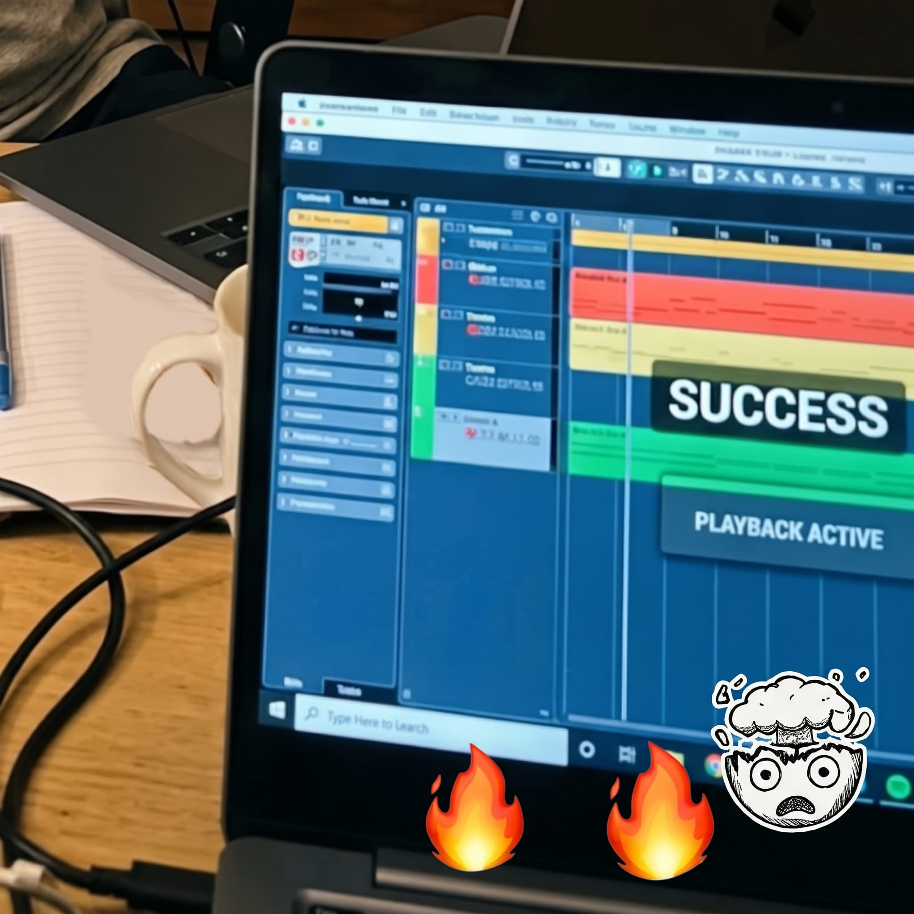

# Newb

Learn what a DAW is by doing it, inside [LUNA](https://www.uaudio.com/luna). Newb is an
interactive course in a window beside LUNA: each lesson explains an idea, gives you something to
do in LUNA, and ticks it off when it sees you've done it.

## The course

1. **DAW basics:** what a DAW is, the Timeline and Mixer pages, bars, beats and tempo, the
   click, and the transport (play, stop, move, loop).
2. **MIDI & instruments:** instrument tracks and plugins, playing on your computer keys, MIDI
   as notes not sound, swapping instruments, velocity, and undo.
3. **Mixing & effects:** faders, dB, pan, mute and solo; EQ, compression and A/B with bypass;
   a reverb bus fed by sends.
4. **Recording & export:** sample rate, buffer and latency; inputs, arming, count-in and
   headphones; recording a take; automation; exporting your mix. Plus a glossary.

The music to work with is an original groove written for Newb, in the style of 1980s digital
dancehall: a busy synth bass over a drum machine.

- **Steps tick themselves off** as Newb sees them happen in LUNA. Stuck? **Show me** does it for you.
- **Underlined words ◎** show you the thing in LUNA: a track, a clip, bars on the ruler, a plugin window.
- **Each lesson sets itself up**, so you can jump ahead.
- Newb works in its own **lesson session**, so your real music is never touched. Every time you
  open Newb, the course starts fresh.

## Install

Requires LUNA 3.1.1 or later on macOS. It uses Apple's built-in General MIDI synth, so nothing
else needs to be installed; UA plugins are used for effects where you have them.

- **From this repository:** in LUNA, Settings > ADD ONS > MARKETPLACE > IMPORT URL, and paste
  `https://github.com/shawngrona/luna-newb`.
- **From a file:** download `Newb.lunaaddon` from the
  [latest release](https://github.com/shawngrona/luna-newb/releases/latest) and open it.

Then open it from **Add Ons > Windows > Newb** and press **Start**.

## Feedback

Found a step that doesn't tick, or an explanation that confuses? Please
[open an issue](https://github.com/shawngrona/luna-newb/issues).

## Development

Plain HTML and JavaScript (`index.html`, `main.js`, `logic.js`, `lessons.js`), built with the
LUNA Builder SDK, whose script bundle is in `vendor/`.

```sh
npm install        # needs the LUNA Builder SDK; point the devDependency in package.json at your copy
npm test           # unit tests: every lesson's checks, the groove, the links into LUNA
npx ua-builder serve     # run it in a browser against a running LUNA
npx ua-builder install   # link it into LUNA's Add Ons folder
npx ua-builder pack      # build the .lunaaddon
```

`tests/live/drive.mjs` runs the whole course against a running LUNA (see its header).

## Licence

MIT, see [LICENSE](LICENSE). `vendor/luna.global.js` is the LUNA Builder SDK, © Universal Audio,
Inc., under the Apache License 2.0 (see `vendor/`). Newb is an independent Add On, not an official
Universal Audio product. LUNA is a trademark of Universal Audio, Inc.
